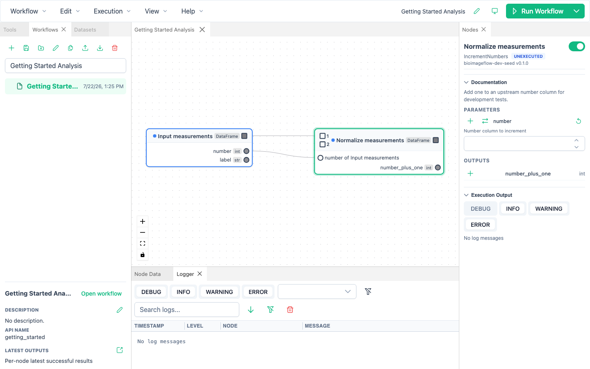

# Build a Workflow

A workflow connects analysis tools on a canvas.
Each node performs one task, and each edge sends data to another node.

## Create and save

1. Choose **Workflow → New**, or click **New workflow** in **Workflows**.
2. Enter a workflow name, display name, and optional description.
3. Add and connect nodes.
4. Choose **Workflow → Save** or press Ctrl/Cmd+S.

An asterisk in the workflow tab means that the canvas contains unsaved changes.
BioImageFlow keeps accepted canvas changes available for recovery, but it updates the saved workflow only when you use **Save**.

## Add a tool

1. Search in **Tools**.
2. Click its row to read the tool information at the bottom of the panel.
3. Double-click the row to add it at the default position, or drag it onto the canvas.
4. Select the new node to edit it in **Nodes**.

Double-click the displayed node name to rename that step without changing the tool it uses.
Disable a node when you want to keep it on the canvas without running it.

If the tool you need is missing, see [Find and Manage Tools](data-and-tools.md).

## Configure inputs

The **Parameters** section uses controls suited to each input, such as text fields, number fields, choices, checkboxes, and paths.

- **Reset to default** restores the value defined by the tool.
- **Set to null** supplies an explicit null when the input permits it.
- **Add input pin** shows an available connection handle on the node.
- **Expose as workflow input** makes the value available to a parent workflow.

Workflow nodes use these same controls for their exposed parameters.
For those fields, **Reset to default** removes your override and returns to the workflow's public default or inherited child values.
Connected parameters show their source; disconnect the edge before editing the value or hiding its pin.
Hiding a pin does not remove a public workflow input.

Use a **Files** node for a group of input files or one source directory.
Use local pickers or drag local files and folders onto the canvas.

## Connect nodes

Drag from an output handle to a compatible input handle.
A field connection sends one named output into one input.
A DataFrame connection sends a whole table.

Three parallel field wires mean the downstream tool processes table rows independently.
Three wires that merge into one mean the downstream tool combines the rows into one batch operation, such as creating one mosaic from an image column.
Whole-table connections use a thicker gray wire with a table badge.

BioImageFlow prevents obvious cycles and validates every connection before saving or running.



## Choose outputs

The **Outputs** section lists what the selected tool produces.
Use **Expose as workflow output** when a parent workflow should receive that value.
Give each public output a clear name.

### Name files with output templates

For a processing tool that writes files, **Outputs** contains an editable **output path template**.
A template is a filename pattern: BioImageFlow replaces the parts in braces with values for the current input.
You can keep the tool's default or customize it.

For example, if the tool has an input called `input_image`, this template:

```text
segmentation/{input_image.stem}_mask_{row_index}.tif
```

produces `segmentation/cell_01_mask_3.tif` for an input named `cell_01.tif` at row index `3`.
These paths are relative to the tool's managed result files; use **Open latest outputs** to find them after a run.

| Template part | Meaning |
|---|---|
| `{input_image.stem}` | Input filename without its extension; replace `input_image` with the tool's actual input name. |
| `{input_image.name}` | Input filename including its extension. |
| `{row_index}` | Input table row index, useful for separate per-row files. |
| `{group_index}` | File-group index, useful when several rows contribute to one file. |
| `{node_name}` | Current node name. |
| `{column:sample}` | Value in the input table's `sample` column. |

Keep a distinct destination for every file the tool writes.
The description below each output explains whether it writes one file per input row, one for the whole batch, or one per group.
For grouped files, use a value shared by the group, such as `{group_index}`, rather than a different filename for every contributing row.
Changing a template changes naming, not how the tool groups inputs.

A **naming base** is a pattern from which the tool generates its own final filenames.
Outputs that refer to existing files, and DataFrame tools that return table columns, have no filename-template editor.

If declared output paths collide during execution, a dialog explains the template and shows how its parts resolve to the conflicting filename.
You can cancel, or change the template and continue with a new run that reuses available cached results.
The change updates your workflow draft without automatically saving it.
Changing filenames can affect downstream tools that interpret names.
Warnings during editing appear only when a conflict is known; missing upstream data does not produce a speculative warning.

Existing workflows retain their pinned tool-package versions.
Update incompatible tool dependencies explicitly; installing a newer package does not rewrite existing workflows automatically.

## Group related steps

Select one or more nodes, right-click the selection, and choose **Group into workflow**.
The grouped steps become one workflow node, and their outside connections become workflow inputs and outputs.

See [Reuse and Nest Workflows](nested-workflows.md) to edit and reuse the group.

## Fix validation problems

Workflow-wide problems appear above the canvas.
Node and parameter problems also appear on the affected item.
Select the named node, correct its field or connection, and wait for synchronization to finish before saving or running.

A path such as `segment_and_measure/cellpose_segmenter` points through a nested workflow.
Open each named workflow node until you reach the affected tool.
