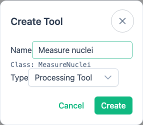

# Create Custom Tools

Custom tools turn your Python code into steps you can connect on the canvas.
There are two ways to keep and share that code:

- A **workflow-local tool** is stored inside one workflow's folder.
  Use it for analysis-specific code or a first prototype: duplicating or exporting that workflow carries the code with it, and each copy can be edited independently.
- A **reusable tool package** installs tools into the shared Tools catalog with explicit versions.
  Use it when several workflows or collaborators should use the same maintained implementation and choose when to upgrade.

## Choose a tool type

**Processing Tools** perform analysis on input values, often one image per table row: for example, filtering images, segmenting nuclei, or measuring objects.
They run in managed execution environments and can declare output filename templates for files they create.
A processing tool can also combine several rows in one operation, such as building a mosaic.

**DataFrame Tools** create or transform whole tables (pandas DataFrames): for example, listing input files, filtering rows, joining measurements, or calculating a summary table.
They receive connected tables as whole-table inputs and run in the application process.
Choose this type for table operations, rather than for image processing that needs its own dependencies.

## Create a workflow-local tool

With the intended workflow active:

1. Click **Create Tool** at the bottom of **Tools**.
2. Enter a readable **Name**.
3. Choose **Processing Tool** or **DataFrame Tool**, using the descriptions above.
4. Click **Create** to generate the Python source.
5. Complete the generated Python source in the code editor.
   Follow the [BioImageFlow custom-tool guide](https://bioimageflow.readthedocs.io/en/latest/how-to/custom_tool.html) for the input/output declarations, processing methods, and dependency recipe.
6. Save the Python file, then add the tool to the canvas and connect its inputs.
7. Run the workflow and inspect the result in **Node Data**.

## Edit an existing custom tool

Select its node and click **Open tool script** in **Nodes**.
This opens the source used by that node, including custom tools from imported workflows.

Save the Python file in the code editor before running: unsaved editor text is not executed.
BioImageFlow refreshes the tool's inputs, outputs, and parameters from the saved code.
If those declarations changed, review any out-of-date-node prompt and check the affected connections before continuing.
If the saved code cannot be loaded, correct the reported error before running again.
Editing code during an existing run affects the next run; it does not replace code already executing.

Inside a nested workflow editor, opening a custom source creates a private editable copy.
Save the nested workflow to apply it to the parent, or discard that nested draft to leave the parent's code unchanged.

Open **Manage tools** to open, rename, or delete editable workflow-local tools.
Before deletion, BioImageFlow identifies saved workflows that still use the tool.

## Create a reusable tool package

Choose a package when the tool needs releases, version selection, reuse across workflows, or distribution to other users.
Packaging is separate from the **Create Tool** dialog.

Follow the [BioImageFlow library guide to creating a custom tool](https://bioimageflow.readthedocs.io/en/latest/how-to/custom_tool.html) for the package structure and Python API.
After publishing or archiving the package, install it through [Find and Manage Tools](data-and-tools.md#install-a-package-from-another-source).
