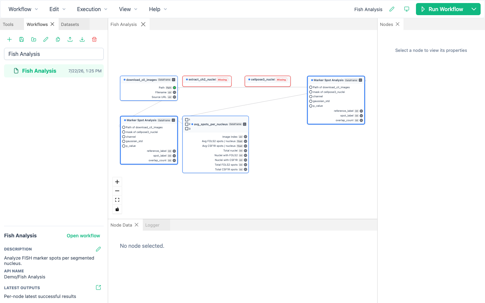

# Getting Started

This walkthrough installs the desktop application and runs the bundled **Fish Analysis** demo.
See [Choose Input Data](choose-input-data.md) before adding your own files.

## Install the desktop application

Download the launcher for your operating system from the [release page](https://github.com/Inria-SAIRPICO/bioimageflow-platform/releases), extract it to a stable location, and launch it while connected to the internet.
Use **Applications** (or `~/Applications`) on macOS, a folder such as `%LOCALAPPDATA%\Programs\BioImageFlow` on Windows, or `~/Applications/BioImageFlow` on Linux.
Keep the extracted package together and outside temporary folders such as Downloads.
Choose the launcher linked in the release notes, rather than the source-code ZIP.

The first launch asks where to install the application, then downloads and prepares it.
Accept the suggested installation folder unless you need another disk.
Setup can take several minutes; keep the launcher open while progress is displayed.

```{note}
**What is stored where, and what happens during updates?**

The launcher, application, and your analysis files have separate locations.
Here `~` means your home folder (`C:\Users\<you>` on Windows).

| Files | Default location | When updating |
|---|---|---|
| **Launcher** — the program you open | The stable folder where you extracted the download | Keep using it: it checks for application updates. Replace it only when release notes request a newer launcher. |
| **Application files and application Python environment** | The installation folder selected on first launch, under `sources/` and `wetlands/` | Managed by the launcher; new releases install new code and prepare the matching environment. Reinstalling here can replace these files. |
| **Workspace** — workflows, custom tools, and results | `~/BioImageFlow/workspace/` | Reused; an application update does not replace your workflows or results. |
| **Settings** — preferences, workspace selection, and viewer configuration | `~/.bioimageflow/settings.json` | Reused by the new application. |
| **Installed tool packages** — versioned tool definitions | `~/.bioimageflow/tool_packages/` | Reused; workflows keep their selected package versions. |
| **Tool and viewer environments** — dependencies used to execute tools and open images | `~/.bioimageflow/wetlands/` | Reused when compatible; an environment may be updated or rebuilt when its requirements change. |

**Wetlands is the environment manager**: it installs and runs dependencies in isolated environments so tools can use different software versions.
The launcher's `wetlands/` directory serves the application itself; the profile's `~/.bioimageflow/wetlands/` serves tools and integrations.

The suggested application installation root is `~/Library/Application Support/BioImageFlow` on macOS, `%LOCALAPPDATA%\BioImageFlow` on Windows, or `~/.local/share/BioImageFlow` on Linux.
Launcher state (including the selected installation location) is kept under `~/Library/Application Support/BioImageFlow`, `%APPDATA%\BioImageFlow`, or `~/.local/state/BioImageFlow`, respectively.
Custom installation choices and environment-variable overrides can change these defaults.
Use [Storage preferences](preferences.md#storage) to find your actual workspace and tool store, and keep your analysis files in the workspace rather than the application installation folder.
```

## Open a bundled demo

BioImageFlow normally installs **Fish Analysis** and **Parameters Space Exploration** in the **Demo** folder when it creates a workspace.
It also installs their required tool-package versions in the shared tool store.
First-time setup needs an internet connection to download missing packages.

1. In the **Workflows** panel, expand **Demo**.
2. Select **Fish Analysis** and read its description.
3. Click **Open workflow**.

If the **Demo** folder is missing, choose **Edit → Preferences...**, open **Storage**, and click **Install demos**.



## Inspect its tools

Demo installation prepares its tool packages before the workflows appear.
Click **Manage tools** in the **Tools** panel to inspect packages and environments individually.
If packages were later removed, use **Manage tools** to reinstall the exact versions listed by the dependency dialog.

```{warning}
Tool packages contain executable code.
Install packages only from sources you trust.
The first run can take longer while BioImageFlow prepares tool environments and downloads the demo's public input data.
```

## Run and inspect the demo

1. Click **Run Workflow** in the upper-right corner and follow progress on the canvas and in **Logger**.
2. Select a completed image-producing node to show its results in **Node Data**, which is open by default.
   To inspect a marker branch, double-click **FOLS2 Marker Spot Analysis** or **CSF1R Marker Spot Analysis**, then select an internal node with image outputs.
3. In an image cell, use **Open in Napari** for interactive desktop viewing or **Open in Avivator** for a supported image in the web viewer.
   If Napari needs setup, follow the environment guidance; see [Image viewers](preferences.md#image-viewers) for configuration.
4. Use the cell's **Reveal in file browser** action to find the image on disk.

You can also select the workflow in **Workflows** and click **Open latest outputs** to browse its output folder.
For copies you can share or move, use [Workflow → Export](manage-workflows.md#import-or-export).

## Make an editable copy

Keep the bundled demo unchanged while you experiment.

1. Select **Fish Analysis** in **Workflows**.
2. Click **Duplicate workflow**, or choose **Workflow → Save As** while the demo is open.
3. Enter a new workflow name and display name.
4. Change a parameter or node, then choose **Workflow → Save**.

Continue with [Interface Tour](interface.md) or [Build a Workflow](build-workflows.md).

The launcher checks for application updates when it starts.
Launcher version information and workspace storage are covered in [Settings, Storage, and Integrations](preferences.md).
